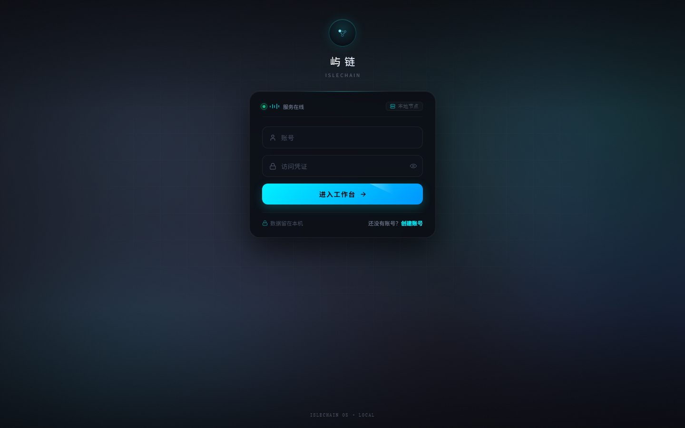

# IsleChain

**一句话出图、出片、出模型 —— 一个工作台走完。**

IsleChain（屿链）是一个本地优先的 AI 创作工作台，Windows 桌面版与本地 Web 服务两种用法。文字变图、图变图、图变模型，产出的东西直接落到无限画布上摆放、拼接、继续加工；每一张成品自动进本地素材库，账号、画布、会话、图片全都留在自己的机器里。



## 能做什么

### 无限画布

- 节点式画布：图片、生成、输出、模型、音视频节点随便摆，连线即流程
- 节点上直接涂遮罩、裁剪、扩图，结果就地预览，原图与结果可对比
- 小导航栏定位、日志面板看进度；画布可存档，删错了能进回收站捞回来
- 和素材库双向联动：画布上取库里的图，库里一键跳到对应的画布

### 图像生成

- 文生图：把角色、画师、预设、固定提示词、LoRA 存成「提示词方案」，随机或顺序抽取，一键套用
- 主按钮长按即开自动连跑，计次或定时两种节奏，运行中有进度和倒计时
- 参考图、图生图、一次多张，2–4 张自动拼图摆放，点开看全套大图
- 智能提示词：短句扩写成完整描述，本地与在线两条通道随切

### 图像编辑

- 图片编辑、贴图重绘、3D 视角变换、三视图
- 高清修复、扩图、CG 细化、2D 风格细化、去水印
- 一键抠图、文字抠图、万物移除
- 图像反推提示词、海报设计

### 视频与语音

- 多段导演台：等宽卡片配比例时间轴，分段拼镜、镜头强度、音频轨各自成段
- 图生视频、文生视频，单条记录留档可复跑
- TTS 配音，音色与体裁可注册扩展

### 三维与材质

- 文生三维模型，窗口里直接预览、转视角、导出
- 材质设计器：材质预设、贴图生成，挑中一套直接落到模型材质槽位
- 模型统计（面数、尺寸、材质数），画布里的资产能送进本机三维工程接着做
- 三视图出图配视角变换，一个模型补齐多个角度

### 对话

- 多轮对话、流式输出、会话留档，文本与出图两种模式
- 画布里也有对话节点，边聊边改提示词，不用来回切页

### 素材库

- 生成结果、上传素材、画布资产统一入库，不再散在文件夹里
- 类型、标签、收藏筛选，名称与时间排序，瀑布流排布
- 右键批量操作，评分备注随手记，点开就是大图预览

### 桌面端

- Windows 桌面版：本地服务跟着窗口一起起，双击就用，不用开终端
- 覆盖层模式：窗口贴在其他软件上方，当随手可见的参考板
- 托盘常驻，关掉窗口不打断后台任务

### 其他

- **多账号**：注册登录、访客只读、管理员管用户，账号之间数据互不可见
- **局域网共享**：同网段其它设备用浏览器就能进来
- **本地优先**：图片、画布、会话、账号都是本机文件，备份和迁移就是拷目录
- **界面外观**：主题、背景、面板透明度，整套界面一起换

## 快速开始

需要 Windows 与 Python 3.10+。

```powershell
git clone https://github.com/ARTpace/islechain.git
cd islechain
pip install -r requirements.txt
python main.py
```

- 也可以直接双击 `启动.bat`，会检查依赖、释放端口并打开浏览器
- 服务起在 <http://localhost:7000>，首次进入先注册账号；用户名为 `admin` 时自动是管理员
- 生成能力依赖本机的模型服务或在线密钥，在「设置」里填好即可使用；只用对话和素材管理可以先跳过

桌面版需要 Node.js 20+：

```powershell
npm --prefix desktop ci
npm --prefix desktop run dev     # 开发模式，改前端自动重建
npm --prefix desktop run build   # 打安装包，产物在 desktop/src-tauri/target/release/bundle/
```

## 仓库结构

```
islechain/
├── main.py            # 服务入口
├── core/              # 业务实现：生成、画布、三维、材质、账号、素材
├── routers/           # HTTP 接口层，按业务拆分
├── static/            # 页面、前端模块与样式
├── workflows/         # 可分享的工作流与配套配置
├── packs/             # 角色、画师、风格、内容包（含各自的 *-packs 目录）
├── desktop/           # 桌面壳与打包脚本
├── tests/             # 自动化测试
└── docs/              # 设计文档与运行说明
```

## 文档

- [架构说明](docs/architecture.md)
- [接口清单](docs/api.md)
- [前端模块](docs/frontend-modules.md)
- [画布与统一资产](docs/unified-assets.md)
- [材质链路](docs/material-workflow.md)
- [桌面覆盖层设计](docs/desktop-overlay-design.md)
- [目录与提交约定](docs/repository-layout.md)
