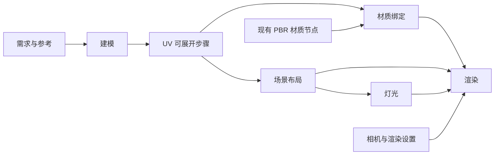

# Blender 分阶段节点工作流开发方案

> 状态：开发设计，尚未实现。2026-11-08 根据当前项目源码与本地参考仓库重新整理。
> 本文替代旧版“给 blenderGen 增加信号插座”的方案。目标扩大为建模、材质、场景、灯光和渲染的可视化工作流；不把现有提示词检查点描述成已实现的流程引擎。

## 0. 目标与验收原则

用户可以看清每步输入、输出与版本，单独调整、重做、比较、采用某一步产物，并保留其他步骤的结果。默认只运行当前步骤，不自动重跑下游。

“不影响其他流程”的准确含义：不改写上游文件、不覆盖其他步骤已采用版本、不自动替换下游输入。模型轮廓、拓扑或 UV 改变后，材质绑定、摆放与最终图像可能需要重新检查；不能承诺上游变化后下游结果仍然正确。

必须实现以下场景：

- 只改木头颜色：模型版本、UV、场景布局、灯光参数保持原版本；生成新的材质候选，用户决定是否更新渲染输入。
- 只移动场景里的椅子：不重新建模、不重新生成材质；新建场景布局版本。
- 只调灯光：不覆盖模型、材质或摆放；新建灯光版本，按需重渲染。
- 修改模型拓扑或 UV：保留旧材质和旧成图；提示对应材质需重新检查，禁止静默套用不兼容绑定。
- 任一步失败、取消或应用重启：上一份成功且已采用的结果仍可查看和继续使用。

### 0.1 已确认的工作方式

默认一个制作项目对应一个持续编辑的主 Blender 工程，例如 `房间.blend`。用户在这个工程里制作多个模型、调整 UV 和材质、搭建场景、打灯并渲染；画布节点划分职责和版本，不强制划分工程文件。独立资产工程只作为可选的导入来源。

首次创建项目时才初始化工程。后续 AI 和人工均在已有工程、已有对象上继续迭代；每次请求创建新 run 是任务记录，不是新建空工程。不得默认清场、重建模型、调用恢复出厂设置或加载空文件。需要破坏性重建时须先展示范围并由用户明确触发。

主工程是可变工作区；发布的节点版本与工程快照是不可变记录。保存快照不切换用户当前制作工程，也不要求用户每次打开不同副本。临时隔离文件仅用于检查、恢复或冻结输入渲染。

## 1. 当前工具实际具备什么

以下来自本次源码检查，不代表运行验证通过。

| 能力 | 当前实现 | 可复用部分与缺口 |
|---|---|---|
| AI 建模 | `static/nodes/blender-gen/index.js` → `routers/dcc_bridge.py` → `core/blender_modeller.py` | 已有节点、作业、参考图、基准模型、面数预算；一次 agent 会话仍跨多个工序 |
| Blender 操作 | `core/blender_modeller.py` 的 `ALLOWED` | 仅 `blender/get_scene_info`、`blender/execute_blender_code`、`blender/look`；渲染等动作需通过执行代码完成，先验证实际能力 |
| 作业与文件 | `core/dcc_bridge.py` | 有创建、保存、投递、扫描产物和检查点；没有不可变阶段版本与依赖契约 |
| 灰模审核 | `POST /api/dcc/jobs/{id}/approve-stage` | 已有人工放行和继续细化；当前同 job 续跑，不等同于独立步骤版本 |
| 中间模型 | `checkpoints/01-blockout.glb`、`02-structure.glb`、`03-material.glb` | 主要由提示词要求 agent 导出；GLB 无法完整保留修改器、程序材质和 Blender 渲染状态 |
| 可编辑源 | 部分手册要求 `source.blend` | 不能据此认为每步都有经过验证的独立源快照 |
| 质量检查 | `core/glb_stats.py`、建模器的面数/UV记录 | 可作为机器检查基础；UV 覆盖与面数不等于造型、拓扑、贴图适配验收 |
| PBR 材质 | `static/js/canvas-materials.js`、`routers/materials.py`、`core/material_maps.py` | 复用颜色/法线输入、PBR任务和材质预览；生成贴图不等于已绑定到 Blender 资产 |
| 场景数据 | `core/game_scenes.py` | 存在游戏场景领域代码；不预设它与 Blender 场景可直接互通 |
| 资产回写 | 建模节点改造路径可覆盖目标资产并递增 revision | 新工作流必须避免把输入资产覆盖成输出；“显式发布到资产”与“生成候选”分开 |
| 画布扩展 | `static/nodes/README.md`、节点目录规范 | 复用节点注册、渲染、保存；端口语义和版本引用需扩展前后端契约 |

旧节点维持原模式：一个人设选择器映射同名手册，不重新启用历史 `node.skillId`。新工作流不自动迁移或重写旧作业。

## 2. 参考仓库怎样借鉴

参考固定为本地 `docs/blender-skills-reference/`，上游 https://github.com/arjun988/blender-skills ，快照说明记录 commit `904f095d8f36a6e72adaebb08d07f884a074743d`。本次未联网检查最新版本，不把该副本当作运行依赖或可直接执行的项目指令。

| 参考文件（均相对参考仓库） | 借鉴内容 | 与本项目结合 |
|---|---|---|
| `.claude/skills/blender-director/SKILL.md` | 分析 → 计划 → 规格 → 专项工序 → 执行 → 验收 → 交付 | 导演只提出可预览的节点计划；后端决定状态、实际工具调用与产物提交 |
| `.claude/skills/blender-modeler/SKILL.md`、`hard-surface/SKILL.md` | 建模策略、几何约束 | 改写为建模阶段手册，禁止顺手完成灯光、场景等其他阶段 |
| `.claude/skills/uv-workflow/SKILL.md` | UV 工序 | 独立 UV 步骤或建模节点的可展开子步骤，产出新的几何/UV版本 |
| `.claude/skills/materials/SKILL.md`、`texture-workflow/SKILL.md` | 材质与贴图流程 | 材质资源与模型绑定分离，接现有 PBR 任务 |
| `.claude/skills/scene-assembly/SKILL.md` | 集合、链接、场景组装 | 用实例和布局引用模型版本，不直接复制修改源资产 |
| `.claude/skills/lighting/SKILL.md` | 灯光、环境与预览 | 单独灯光包，限定可写对象 |
| `.claude/skills/rendering/SKILL.md`、`camera-cinematography/SKILL.md` | 相机、引擎、采样、输出 | 渲染使用明确输入快照，保存参数、图像及可复现源 |
| `.claude/skills/qa-review/SKILL.md` | 检查表、视觉对照和交付结论 | 机器检查、AI视觉意见、人工采用分别记录 |

这些是知识手册，不提供本项目需要的版本图、事务、队列或节点编辑器。不能把“有导演 skill”视为“已有隔离执行引擎”。只按实际阶段引入手册，不一次搬入全部技能。

### 引入与许可约定

翻译并改写为自包含中文正文，处理外部 references；复用 `core/blender_skills.py` 的正文加载思路，但阶段手册选择由服务端阶段白名单决定，不开放任意路径。保留来源、固定版本、MIT 许可与必要版权声明。原有 `packs/blender-skills/<presetId>/SKILL.md` 继续服务旧节点；新阶段手册目录在首个阶段实施时确定，避免与原有“人设同名绑定”混用。

## 3. 用户看到的流程



图表示依赖，不是每次必须从左向右重跑。场景可以组合多个模型；首期单资产链路验收通过后再开放多资产场景。相机首期放在场景的独立配置区域，渲染设置保存在渲染节点；有复用需求时再拆相机节点。

### 节点和操作（已确认的图形化方向）

默认画布只创建一个“Blender 场景”主节点，内部保留建模、UV、材质、布局、灯光、渲染的独立状态和版本。切换的是当前面板，不是改变节点类型，不清空其他工序。多个资产通过预览选择或资产缩略图切换。独立工序节点仅作为后续按需展开的引用入口，不复制数据。

布局参考用户提供的两张卡片截图：左侧图标配短名称工序导航，右侧大预览和当前工序操作；深色圆角面板，分段选项、滑块和色块优先。高级设置用锚定弹层或折叠区；默认不铺开参数、日志、长提示。主体唯一视觉焦点是场景/资产预览，唯一主操作随工序变化。删除默认长说明、常驻多按钮工具栏、无关订阅信息和多层卡片套叠。

画布紧凑卡片提供预览、工序图标和一个主操作；展开工作面板后才显示完整工序导航与设置。图标须有title/可访问名称，选中工序显示短名称；关键错误、跨范围影响与未接通能力不能仅靠颜色或悬停提示表达。

预览支持本步对象/完整场景、固定视角的前后对照；每步保存场景缩略图。Blender连接到当前主工程时，人工修改实时可见，AI代码执行刷新后可见；视口不是AI逐动作动画，最终渲染仍需计算。历史结果在独立预览展示，不覆盖工作现场。

每步逐步接入AI修改、参数直调和人工编辑，版本放进缩略图抽屉。候选不自动采用，下游固定具体版本。未接入执行器的工序显示“尚未接通”，禁止通过旧建模接口冒充执行。

首个实现增量复用现有blenderGen类型增加sceneWorkspace模式及独立界面文件，避免提前复制所有连线和保存规则；旧节点面板不变。该增量仅接通现有建模任务，不宣称具备主工程绑定、局部版本和其他阶段执行。后续底座完成后再接入工作流协议，是否新增独立类型由迁移需求决定。

## 4. 阶段职责与产物合同

| 阶段 | 必需输入 | 允许修改 | 必须保留的产物 | 核心检查 |
|---|---|---|---|---|
| 建模 | 需求、可选参考/基准模型版本 | 本次资产几何与建模修改器 | `source.blend`、预览 GLB、尺寸/面数报告、缩略图 | 文件可打开、对象/尺寸合法、预算与外观差异 |
| UV | 模型版本 | UV；如需拓扑修改须显式启用并标记 | 新 `source.blend`、预览 GLB、UV布局图、兼容签名 | UV存在、退化/越界/重叠按资产规则检查 |
| 材质绑定 | 模型/UV版本、材质包或需求 | 材质节点、材质槽绑定、纹理资源 | 材质包、绑定清单、预览源和图片 | 贴图存在、色彩空间、槽绑定与UV兼容 |
| 场景布局 | 一个或多个模型版本 | 实例增删、变换、集合与相机布局 | `layout.json`、场景 `source.blend`、预览 | 引用可解析、实例ID唯一、变换合法 |
| 灯光 | 场景版本 | 灯具、World/HDRI；曝光归灯光管理 | `lighting.json`、资源清单、测试图、预览源 | 灯光/HDRI可解析、几何布局未变 |
| 渲染 | 场景、材质绑定、灯光、相机与渲染设置 | 引擎、采样、分辨率、输出、视图变换 | PNG；按需 EXR、实际配置、可复现 `source.blend` | 图像可解码、尺寸/色彩配置正确、输入版本完整 |

共同规则：`.blend` 是可编辑源，GLB 是交换/预览格式；不能用一条 GLB 串起全部程序材质、集合、灯光和渲染状态。报告区分“通过”“失败”“未检查”。有预览但缺必需产物的任务只能标为部分产出，不能标成功或自动采用。

### 组合与解耦

- 工程写入稳定 `projectId`，每个模型根集合写入 `assetId`，对象有 `objectId`，场景实例有 `instanceId`。节点绑定 `projectId + scopeId + stage + selectedRevisionId`，其中模型范围的 `scopeId` 为 `assetId`，布局/灯光等使用其独立范围ID。
- 多个建模节点默认连接同一主工程，但各自创建/绑定不同资产集合；同一资产不同工序共享资产ID并限定各自可写字段。同一范围同一工序只允许一个活动写入者；重复绑定节点只能只读或显式转交管理权。
- 节点不是按当前选择、集合显示名或文件名寻找模型。重命名不改变绑定；复制资产须生成新资产/对象ID，关联实例保留资产引用并生成新实例ID。导出丢失ID时必须有 sidecar 映射。
- 材质资源独立于几何；绑定记录 `objectId + slotId + materialRevision`。同一材质包可复用，绑定则针对明确的模型/UV版本。
- 主工程内通过资产根集合与实例组织场景，布局只管理实例变换和引用关系，不要求把每个模型导出到独立工程再整合。局部恢复时按ID载入对应版本的数据块并重新绑定引用；外部资产可 Append 导入，暂不引入跨文件 Library Override 自动合并。
- 灯光包按角色/目标实例保存灯具与环境，装配时解析目标；目标被删除时报告冲突。
- 交互预览可使用主工程当前草稿；正式版本渲染在任务目录按冻结输入生成快照，可由后台实例执行，不切换主工程。各阶段完整 `.blend` 只是恢复载体，不能把旧灯光源里的旧几何覆盖到当前工程。
- 渲染装配顺序固定：加载场景与指定几何 → 应用材质绑定 → 灯光/环境 → 相机 → 渲染参数。禁止悄悄混用“各步骤最新版本”。

### 4.1 同工程多节点绑定示例

| 主工程 | 节点 | 管理范围 | 独立采用版本 |
|---|---|---|---|
| 房间.blend（project_room） | 椅子建模 | asset_chair 根集合的几何 | 椅子 v3 |
| 同上 | 桌子建模 | asset_table 根集合的几何 | 桌子 v2 |
| 同上 | 椅子材质 | asset_chair 的材质与绑定 | 材质 v4 |
| 同上 | 场景布局 | instance_chair_01/02、instance_table_01 的摆放 | 布局 v5 |
| 同上 | 灯光 | lighting_room、World 与曝光 | 灯光 v2 |
| 同上 | 渲染 | 相机选择、渲染配置与成图 | 成图 v6 |

同一工程可有多组模型、多个材质步骤和多组灯光方案；版本号属于节点管理范围，不是整个工程统一升级。椅子提交v4不使桌子v2变成v3。快照中其他范围的数据只用于上下文，不能成为局部回退的写入来源。

### 4.2 人工介入与参数直调

编辑会话流程：定位绑定范围 → 获取人工编辑租约并记录基线 → 在当前主工程编辑 → 保存/收集差异 → 检查范围与兼容性 → 生成候选 → 采用或保留草稿。进入人工编辑后，暂停同工程AI写入；“暂停”须等正在执行的工具调用结束并确认停止，不能在任意Python执行中途声称已安全暂停。

灯光位置/角度/强度、物体变换、材质颜色/粗糙度等常见属性提供节点控件，使用确定性Blender脚本直接设置；拖动可节流预览，松开后记录草稿，用户提交时生成版本，不把每次鼠标移动当作新版本。UV与顶点编辑使用Blender原生工具。参数写入同样服从工程租约和范围检查。

人工编辑不可能仅凭当前选择判断全部变化。通过Blender侧编辑会话接入、数据变化通知与保存时签名比较，识别几何、UV、材质、变换、灯光、相机等实际差异；发现跨范围修改时列出受影响节点，允许明确提交多范围版本，或继续保留草稿，不静默归入单个节点。AI执行期间检测到人工改动应停止后续写入并报告冲突。

共享网格、材质、节点组、贴图和World都有可能跨资产影响。微调前显示使用者；用户可选择“仅本资产”（复制共享数据后改）或“更新所有使用者”（显式多范围提交）。不能把共享数据变化标为只影响一个模型。World等全局设置由明确的灯光范围管理，多方案切换是显式操作。

取消/撤销编辑只恢复该会话确认的范围；若有其他修改插入，先报告冲突，不直接恢复整份旧blend。无法可靠局部恢复时保留草稿与备份，停止自动回退。

## 5. 版本、依赖与更新规则

### 5.1 不可变版本

每次运行创建新 run，输入在入队时解析成具体版本并冻结。运行成功后才允许发布 revision；一个已发布版本的文件与清单不再改写。失败重试新建 run，保留上次成功版本。

建议最小清单如下；字段为拟议协议，尚未加入现有数据结构：

```json
{
  "schemaVersion": 1,
  "revisionId": "rev_material_003",
  "nodeId": "node_material",
  "projectId": "project_room",
  "scopeId": "asset_chair",
  "baseProjectRevision": "project_snapshot_012",
  "editOrigin": "manual",
  "stage": "material",
  "runId": "run_003",
  "parentRevisionId": "rev_material_002",
  "inputs": [
    {"port": "model", "revisionId": "rev_uv_002", "manifestHash": "sha256:..."},
    {"port": "material", "revisionId": "rev_pbr_004", "manifestHash": "sha256:..."}
  ],
  "params": {"presetId": "hard-surface"},
  "executorVersion": "blender-stage-v1",
  "blenderVersion": "实际探测值",
  "recipeHash": "sha256:...",
  "files": [{"role": "source", "path": "source.blend", "sha256": "..."}],
  "compatibility": {"geometryHash": "...", "uvHash": "...", "slotsHash": "..."},
  "validation": {"status": "passed", "report": "report.json"}
}
```

清单还需记录实际执行脚本/指令、手册内容哈希、模型渠道与模型名、依赖资源清单；API 密钥不入清单。哈希用于追溯与变化判断，不承诺 AI 重新生成逐字节一致，也不在首期自动缓存付费生成。

`manifestHash` 基于规范化清单与资源哈希；`recipeHash` 覆盖冻结输入、参数、指令、手册与执行器版本。不能只拿文件路径、修改时间或 GLB 文件大小判断输入是否改变。

工程保存与节点提交是两种动作：普通 Ctrl+S 保存主工程草稿，不自动让所有节点升级；“提交本步”仅提交明确范围，记录其依赖与实际变化。整工程快照另有 `projectSnapshotId`，内含各范围版本映射和未提交标记，不能替代局部版本。

局部回退必须只替换对应资产几何、绑定、布局或灯光数据；恢复整工程必须作为单独操作显示全工程影响。快照中的共享依赖需要资源闭包和身份映射，不能仅保存根集合名。采用多个范围的关联变化时先验证所有候选，再一次性更新选择映射，避免只采用一半。

### 5.2 三种状态分别保存

- 执行状态：`queued / running / succeeded / failed / cancelled / interrupted`。
- 节点选择：`selectedRevisionId`；候选存在不等于已采用。
- 输入新鲜度：`current / update_available / needs_review / missing_input`；上游变化不把旧成功产物变成失败。

上游采用新版时，直接下游只得到更新提示；保持旧版引用运行的下游及其后续产物仍自洽。下游显式更新输入并产出新版后，才逐层提示更后面的节点；完整链路界面可同时显示间接上游存在新版。

### 5.3 兼容性规则

| 上游变化 | 保留什么 | 更新时怎样处理 |
|---|---|---|
| 材质颜色/粗糙度 | 模型、UV、布局、灯光参数 | 可重新应用绑定并渲染；旧图保留 |
| 模型外形变化、ID/UV/槽未变 | 原材质包、布局数据 | 重新装配并检查穿插、取景和灯光；不能仅凭ID相同判视觉兼容 |
| 拓扑、UV或材质槽变化 | 旧绑定和旧图 | 标 `needs_review`，要求重绑定/重烘焙或人工确认 |
| 场景实例移动 | 模型与材质资源 | 灯光目标关系可复用但需预览检查；重渲染由用户触发 |
| 相机变化 | 几何、材质、灯光包 | 提示重新检查构图与灯光覆盖 |
| 灯光变化 | 模型、材质、布局 | 重渲染；禁止改写材质以伪造灯光效果 |

首期兼容检查保守：从 Blender 网格数据提取几何、UV、槽及ID签名；无法证明兼容就提示检查，不开发通用拓扑映射或自动修复系统。

## 6. 后端执行与 Blender 隔离

### 6.1 最小执行流程

1. 校验画布权限、节点阶段、端口类型、版本归属和资源路径。
2. 冻结输入、参数和指令，创建 run，排入指定 Blender 实例队列。
3. 连接节点绑定的主工程，核对projectId与目标范围；记录编辑基线并备份。已有工作区草稿冲突时提示先提交/保留/撤销，不静默打开旧文件。仅独立验证或冻结渲染任务创建临时副本。
4. 加载本阶段手册和可写范围，执行 AI 操作或确定性参数脚本。
5. 宿主执行最终保存、资源收集与检查；不只相信 agent 声称“已保存”。
6. 在临时目录写文件和报告；必需项通过后同文件系统原子发布清单，成功版本才对外可见。
7. 节点显示候选；用户采用后才变更节点输出引用并通知下游。

目录拟放在现有画布持久化目录下：`dcc-workflows/<workflowId>/runs/<runId>/` 与 `revisions/<revisionId>/`。实施前通过 `core/canvas_paths.py` / `core/canvas_store.py` 核对真正存储边界，不写死仓库目录。首期可复制资源，后续有容量证据再做去重；版本删除仅显式执行并检查引用，不自动清理仍被使用的旧版。

### 6.2 活动 Blender 会话的约束

MCP 连接池锁不等于整个 Blender 作业互斥锁。新阶段执行必须对同一 Blender 实例加完整运行期租约；旧建模器和新执行器也必须共用该租约，否则旧任务仍可能污染新任务。

默认连接用户的主制作工程，人工和AI在同一工程接力；同工程串行写入，通过工程级租约明确当前为“人工编辑”“AI执行”或“空闲”。AI修改前读场景、验证绑定ID并展示范围，只改已有目标；新增资产仅创建对应集合，不新开空工程。不得自动打开文件、清场或覆盖未保存的人工工作。

后台Blender是可选的验证/渲染执行资源，不是每个节点一份新工程。后台修改要合入主工程时，必须比较基线与当前范围签名；基线已变则产生冲突候选，不覆盖用户后续修改。

主工程的资产源、场景实例和共享资源须区分管理，外部blend载入禁用自动运行脚本；但任意Python执行仍不能视为安全沙箱。可写范围提示仅是辅助：宿主比较各范围ID、几何/UV签名、布局与资源哈希，越权修改使本次候选失败、不发布，并保留现场与备份；恢复前验证没有新的人工修改。灯光或材质步骤修改几何时即应拦截。

长渲染不在单次 MCP 调用里同步等待整张图。先验证当前 MCP/插件支持的异步启动或作业查询方式；不支持时使用独立 Blender 后台进程执行冻结的渲染源，记录 PID/日志并轮询。运行超时、取消时只终止本作业拥有的进程，不能杀掉用户 Blender。锁在执行确实停止后释放；渲染时限不沿用建模器固定 900 秒。

应用重启后，检查运行租约与进程，不能把遗留 `running` 当成功或直接重复启动；无法可靠恢复时标记 `interrupted`，保留已采用版本并允许新建重试。

### 6.3 调用协议与最小 API

扩展现有 `/api/dcc` 路由，不另建一套 MCP 连接管理。新阶段执行器先与旧 `build-model` 并行存在，不让旧接口参数含义悄悄改变。

拟议接口：

| 接口 | 职责 |
|---|---|
| `POST /api/dcc/edit-sessions`（拟新增） | 绑定projectId/nodeId/scopeId，获取人工租约、记录基线；返回sessionId |
| `POST /api/dcc/edit-sessions/{id}/commit`（拟新增） | 收集人工/参数修改，校验范围并生成候选；冲突不覆盖 |
| `POST /api/dcc/edit-sessions/{id}/close`（拟新增） | 结束编辑并释放租约；有草稿时明确保留或按范围撤销 |
| `POST /api/dcc/stage-runs` | 入参 `canvasId/nodeId/stage/inputs/params/directives/requestKey`；返回 `runId` |
| `GET /api/dcc/stage-runs/{id}` | 队列/进度/日志/报告/候选版本 |
| `POST /api/dcc/stage-runs/{id}/cancel` | 请求取消；实际停止后再标 cancelled |
| `GET /api/dcc/revisions/{id}` | 查询不可变清单及授权产物链接 |
| `POST /api/dcc/nodes/{id}/select-revision` | 带 `canvasId/revisionId/expectedSelectedRevisionId` 乐观校验后采用 |

`requestKey` 在所属画布与节点范围去重，防止重复点击和网络重试启动两次付费任务。节点运行中改参数只形成新草稿，不影响已经冻结的 run；删除节点也不隐式取消或删除被其他节点引用的版本。

每个接口校验拥有者；客户端下载不能传任意本地路径或外部 owner 的 revision。文件只能由服务端版本ID解析，文件名做路径边界检查。资源找不到要报具体缺失项，禁止从当前 Blender 场景猜测补齐。

## 7. 上游文本和规则优先级

复用 `generatorSources()` 已有 prompt、promptGroup、llm、gamePlan 解析。`webapp` 当前无文本输出分支，首期不宣称支持；确需接入时另定义其可见文本输出，不能把 HTML/脚本直接当需求。

结构化指令项保存 `sourceNodeId/text`，便于追溯。建议初始服务端上限 8 个来源、每来源 4000 字符、合计 12000 字符，最终随渠道上下文预算校准；超限返回明确错误，不静默取前4条或截取600字。界面说明实际接收来源，长策划文本允许用户先选择相关段落。

优先级：执行安全与阶段可写范围 > 用户明确的硬参数（预算/输出合同） > 本节点本次需求 > 上游需求 > 风格/人设通用表述。硬约束冲突需运行前提示，不让模型自行猜。只有上游文本且节点内需求为空也能运行。

灰模放行或手动重试必须复用冻结输入、参数与原始需求，再追加本次修订；不得只保留“继续细化”一句话。旧接口若接入这些字段，首次运行和 `approve-stage` 两条调用都要覆盖。

## 8. 与现有代码结合的改动边界

| 位置 | 计划改动 |
|---|---|
| `static/nodes/blender-gen/` | 旧节点兼容保留；按需提供显式“创建分步工作流”，不自动拆旧节点 |
| `static/nodes/blender-gen/workspace.js`（首期）及后续工作流模块 | 主节点内部工序UI、主工程/范围绑定、AI/参数/人工入口、输入版本、候选比较与采用 |
| `static/js/canvas.js`、`static/js/game-model3d.js` | 阶段类型元信息、带语义端口与连线验证；不把阶段执行逻辑继续塞回画布主文件 |
| `static/js/canvas-generation-sources.js` | 仅在接文本来源时做最小适配，保持其他生成器行为 |
| `core/node_catalog.py`、画布 schema/保存链路 | 注册节点类型，保留端口/版本引用字段；具体白名单在实施时逐项核对 |
| `routers/dcc_bridge.py` | 新API、权限、输入验证、启动/查询/采用；复用旧作业接口约定 |
| `core/dcc_bridge.py` | 复用安全路径、持久化与产物访问；不把旧 job 当新 revision 覆写 |
| `core/blender_workflow.py`（拟新增） | 简单阶段分派、冻结输入、版本清单、队列与发布；先一个文件，实际变大再拆 |
| `core/blender_modeller.py`、`core/mcp_tools.py` | 复用可用工具调用；让旧/新 Blender 作业共享实例租约，不整体重写旧建模器 |
| `routers/materials.py`、`static/js/canvas-materials.js` | 将成功 PBR 任务包装成可追溯材质输入，不重做材质生成系统 |
| `core/canvas_paths.py`、`core/canvas_store.py`、`core/canvas_bundle.py` | 核对持久化、离线迁移和ZIP导入导出；阶段版本及资源闭包必须一同带走 |
| `static/canvas.html`、`static/index.html` | 实际加载页引入新节点脚本、更新资源版本戳 |

首期不引入通用插件引擎、外部调度服务、数据库迁移或新第三方依赖。导演功能排在单步执行链路之后：先能稳定手动执行，再让AI提出建图建议。

## 9. 分阶段开发与退出条件

### UI0：首个可用界面增量（2026-11-08）

新增“Blender 场景”创建入口，复用旧建模节点数据；工序图标切换、主预览、设置折叠与卡片尺寸展开可用。建模复用现有执行链路，其余五步明确显示尚未接通；从未接通工序触发快捷/级联运行也不得提交建模。保留旧入口。此增量不代表P0/P1底座完成，不承诺当前建模器已经遵守新主工程契约。

### P0：验证技术底座

用已有工具验证一个主工程的持续编辑：创建桌子与椅子集合 → 绑定两个建模节点 → 人工微调椅子 → AI在原椅子上继续修改 → 提交椅子版本 → 参数调整灯光 → 局部恢复椅子。验证快照保存、几何/UV检查与小图渲染，并确认Blender侧人工编辑会话接入方式。

退出条件：全程保持主工程身份，不清空重建；椅子修改和局部恢复不改变桌子及布局；人工与AI不会同时写入；快照可重开检查且不切换主工作区。未能实现范围识别与租约时先修底座。

### P1：版本闭环与两个可操作步骤

先实现建模、材质两个阶段与最小版本协议：运行 → 候选 → 检查 → 采用 → 固定输入 → 局部重做。允许导入已有模型起步。纳入主工程/资产ID绑定、单实例队列、权限、重复提交和失败保留，同时提供人工编辑与参数直调入口。

退出条件：模型v1 → 材质v1；只改材质生成v2，模型文件哈希不变；旧材质可恢复；模型v2不自动改变材质v1引用。运行中修改草稿不污染当前任务。

### P2：UV与现有材质节点接入

实现UV步骤、对象/槽ID与兼容签名；从现有PBR任务读取明确版本的贴图，完成真实 Blender 绑定和预览。补全建模灰模审核的冻结上下文。

退出条件：只替换贴图不改变几何/UV；UV变化触发重绑定提示；灰模继续时需求、预算、人设及资源仍在；绑定失败可回退旧版。

### P3：场景布局

在同一主工程内支持多个建模节点分别制作资产，再直接使用集合/实例搭场景；支持移动/旋转/缩放、相机配置与场景快照，不强制跨工程整合。首期不做物理碰撞自动求解或复杂合并。

退出条件：移动一个实例不改源模型；同模型多个实例ID不冲突；缺失或被移除对象的材质/灯光引用可定位；旧布局可继续渲染。

### P4：灯光与渲染

实现灯光包、环境资源、低成本测试图、冻结输入渲染、进度与取消；先静帧PNG，EXR/序列/视频后续按真实需求扩展。

退出条件：只改灯光不会修改场景几何/布局/材质绑定；渲染记录全部输入版本；旧成图不覆盖；长渲染可查询和取消；应用重启后不重复启动。

### P5：导演建议与便捷执行

导演根据需求提出阶段、预算和节点连接草案，界面展示后由用户创建/采用。只允许已支持的阶段，不能由提示词发明新接口。再实现“运行到此处”，运行前显示需更新的依赖与步骤。

退出条件：同一图可手动逐步完成；导演失败不影响现有节点与版本；固定版本不会被自动级联替换；跨画布导出/导入保留全部被引用资源。

## 10. 验证计划

文档改动只做结构/链接与差异自查；以下为未来实现时的检查，不表示本次已执行。

- 状态与版本单元测试：成功发布、失败保留、采用乐观冲突、固定输入、上游更新提示、重复请求去重。
- API测试：拥有者边界、版本归属、非法端口、缺失资源、路径穿越、文本超限。
- 执行测试：同实例旧/新任务互斥、人工/AI交接、阶段越权被拒、取消与重启恢复、发布中断不暴露半成品。
- 同工程实测：桌椅两个节点绑定同工程不同资产；重命名后仍可定位；修改/回退椅子不改变桌子和布局；同一资产实例无ID冲突。
- 人工与参数实测：不调用大模型即可修改UV、灯光角度与顶点；识别依赖变化；Ctrl+S不使全部节点升级；共享材质修改明确展示影响范围；有并发草稿时禁止整工程回滚。
- 节点定向测试：单步运行不级联、候选不自动采用、版本摘要与恢复；沿用现有Node测试模式。
- Blender实测：固定小模型验证材质/灯光步骤前后几何与UV签名不变，保存重开后复核，检查真实渲染图和资源路径。
- 回归现有 `tests/test_blender_modeller.py`、`tests/test_blender_node_ui.cjs`、`tests/test_materials.py` 中直接受影响项；节点脚本语法与 `scripts/check-nodes.mjs` 按实际改动执行，不每阶段机械跑全量或重复付费建模。
- 视觉验收：每步实际预览和最终图人工核对，不能用“提示词出现了某段文字”替代功能验收。

## 11. 回滚与范围

旧 `blenderGen`、已有资产和旧job默认不迁移。首个界面增量采用blenderGen的sceneWorkspace模式；后续工作流采用带版本号清单；关闭新增入口后旧链路仍可运行。新产生的版本文件继续可读，不以关闭功能为由删除。

不做绑定/动画、完整引擎导入、通用拓扑转移、自动合并用户任意blend修改。需要时分别扩展产物合同与验收，不塞进当前阶段提示词。

实施遵循项目节点目录规范、中文注释与LF要求；画布新增分区时更新索引；不自动git提交，不修改参考仓库，不顺手重构当前工作区其他变更。


### 首版参考输入边界（2026-11-08）

- 主预览支持点击图片缩略图查看大图，并可返回模型；切换预览不改变提交内容或参考用途。
- 图片去重后最多提交8张，超过时阻止运行并提示减少，不静默截断；AI图片读取上限同步为8张。后端现支持PNG、JPG/JPEG、WebP，未能解析的本地文件仍可能缺失，不能把缩略图显示当成接收成功。
- 当前图片统一作为视觉参考，未实现造型、材质、布局等用途分配；模型输入只选第一条有效连线作为改造基准，不支持多个模型自动分配。连接的文本尚未合并进建模提示，当前以节点文本框为准；视频、音频、PDF未接通。
- 图片由服务端复制到作业in目录后附给AI，AI再通过工具操作Blender，不等于自动创建Blender参考图对象。实际接收须核对作业缺失项和“参考图N张随请求发送”日志。
